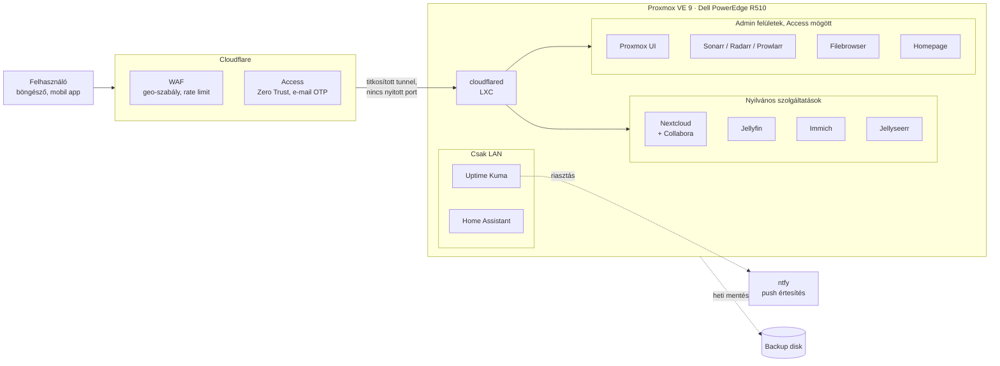

# Homelab

Otthoni szerverinfrastruktúra, amit saját magam építettem és üzemeltetek: egy használt Dell PowerEdge szerveren futó Proxmox VE környezet, amely a családi fotókat, fájlokat, médiát és az okosotthont szolgálja ki. A célom a gyakorlati Linux-, hálózati és biztonsági tapasztalat volt, valódi felhasználókkal és valódi hibákkal.

> A domainek általánosítva vannak (`example.com`), belső IP-címek nem szerepelnek. Jelszó, token vagy kulcs sincs benne.

## Architektúra

## Szolgáltatások

Minden szolgáltatás külön LXC konténerben fut (VM nincs), a legtöbb unprivileged módban.

| Szolgáltatás | Mire jó | Futtatás | Elérés |
|---|---|---|---|
| Cloudflare Tunnel | külső elérés nyitott portok nélkül | cloudflared, natív | – |
| Nextcloud + Collabora | felhő tárhely, online Office, Obsidian szinkron (WebDAV) | Docker Compose (Postgres, Redis, cron) | nyilvános, WAF |
| Immich | családi fotókönyvtár | Docker Compose | nyilvános, WAF |
| Jellyfin | médiaszerver | natív (apt) | nyilvános, WAF |
| Jellyseerr | médiakérések | Docker | nyilvános, WAF |
| Sonarr, Radarr, Prowlarr | médiakönyvtár-automatizálás | natív | Cloudflare Access |
| Filebrowser | webes fájlkezelő | natív, systemd | Cloudflare Access |
| Homepage | kezdőlap élő widgetekkel | Docker | Cloudflare Access |
| Home Assistant | okosotthon | Docker | LAN |
| Uptime Kuma | elérhetőség-figyelés, ntfy riasztás | Docker | LAN |

## Hardver és tárolás

- **Dell PowerEdge R510**, 2× Intel Xeon L5630 (8 mag / 16 szál), 80 GB DDR3 ECC RAM, PERC H700 RAID vezérlő, iDRAC 6.
- Diskek a PERC mögött: RAID1 a fotóknak, külön disk a médiának, LVM thin poolok a konténereknek.
- Külön mentési disk a RAID vezérlőn kívül.

Részletek: [docs/architektura.md](docs/architektura.md)

## Biztonság röviden

- Nincs port forward a routeren, UPnP kikapcsolva. Minden külső forgalom a Cloudflare Tunnelen jön.
- Admin felületek Cloudflare Access (Zero Trust) mögött, egyszer használatos e-mail kóddal.
- Nyilvános szolgáltatások: WAF geo-szabály és rate limit a bejelentkezési végpontokon.
- Proxmox tűzfal default-deny, TOTP kétlépcsős belépés.
- Privilegizált konténerek átállítva unprivileged módra.

Részletek: [docs/biztonsag.md](docs/biztonsag.md)

## Mentés és monitorozás

- Heti automatikus `vzdump` mentés minden konténerről (snapshot mód, zstd, 4 hét megőrzés).
- SMART diskfigyelés (napi rövid, heti hosszú teszt), hiba esetén push értesítés.
- Uptime Kuma figyeli a szolgáltatásokat, ntfy-on riaszt.

Részletek: [docs/mentes-monitorozas.md](docs/mentes-monitorozas.md)

## Runbookok és tanulságok

- [Proxmox VE 8 → 9 frissítés](docs/runbooks/pve8-9-frissites.md)
- [Cloudflare Access az admin felületek elé](docs/runbooks/cloudflare-access.md)
- [Cloudflare WAF szabályok](docs/runbooks/cloudflare-waf.md)
- [Postmortemek: mi romlott el és mit tanultam belőle](docs/postmortemek.md)

## Tervek

- [ ] Gépen kívüli (off-site) mentés, a 3-2-1 szabály szerint, és dokumentált visszaállítási próba
- [ ] Konfiguráció kódként: Docker Compose fájlok a repóban, Ansible az alapbeállításokhoz, Terraform/OpenTofu a konténerekhez
- [ ] Prometheus + Grafana metrikák
- [ ] A rendszerdisk cseréje SSD-re, RAID1-ben
- [ ] Automatikus biztonsági frissítések minden konténerben
